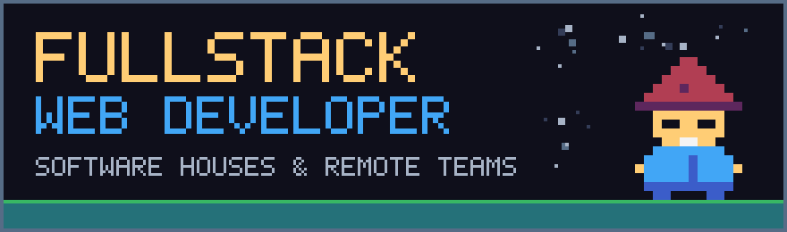
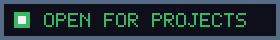
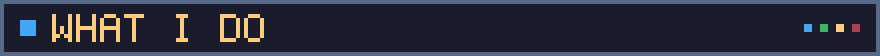
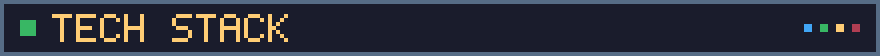
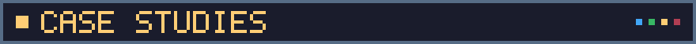
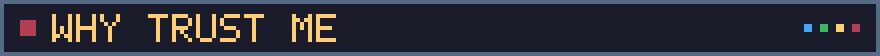
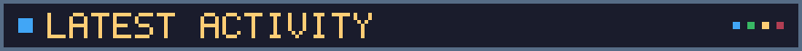
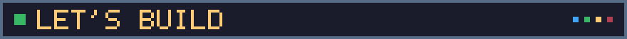

# Hi, I'm Alvio Fadhil Gustian

**Fullstack web developer.**

I build fullstack web apps, from React interfaces to Node.js and Laravel backends, so your team ships on time. Subcontract and white-label friendly.

  
   
  Reply within 24 hours · Working hours: UTC+X · Communication: English

## 

| **Frontend & 3D** | **Backend & API** | **Database & Deploy** |
|---|---|---|
| Responsive React interfaces, fast Vite builds and Three.js scenes. | REST APIs, auth, integrations and admin panels with Node.js and Laravel. | Schema design, query tuning and CI/CD deploys on PostgreSQL and MySQL. |

**How I work**

- NDA and white-label: fine by me.
- Async-first, with N hours of overlap with your timezone.
- Pull-request workflow, with tests and docs included.
- A short written update every week, so there are no surprises.

## 

| Layer | Tools |
|---|---|
| **Frontend** | **`React`** `Vite` `Next.js` `TypeScript` `Tailwind CSS` |
| **3D & Interactive** | **`Three.js`** `WebGL` `React Three Fiber` |
| **Backend & API** | **`Node.js`** **`Laravel`** `Express` `PHP` `REST API` `JWT / OAuth` |
| **Database** | **`PostgreSQL`** `MySQL` `Redis` `Prisma` |
| **Testing** | `Vitest` `Playwright` `Pest / PHPUnit` |
| **Tools, CI/CD & Deploy** | `Git / GitHub` `Docker` `GitHub Actions` `Linux` `Vercel / Railway` `AWS basics` |

Bold = what I use most.

## 

### 1. PROJECT_NAME_1: one-line summary

`Personal project` 

- **Problem:** What was slow, broken or missing.
- **Solution:** What you built, and with which stack.
- **Result:** A number anyone can re-run, for example p95 latency from 480 ms to 90 ms.

[Code](https://github.com/YOUR_USERNAME/PROJECT_REPO_1) · [Live demo](YOUR_DEMO_URL) · [Write-up](YOUR_WRITEUP_URL)

### 2. PROJECT_NAME_2: one-line summary

`Personal project` 

- **Problem:** ...
- **Solution:** ...
- **Result:** For example, a Three.js scene at 60 FPS with a bundle under N KB.

[Code](https://github.com/YOUR_USERNAME/PROJECT_REPO_2) · [Live demo](YOUR_DEMO_URL) · [Write-up](YOUR_WRITEUP_URL)

## 

- All my code is public, with a README, tests and CI.
- N merged pull requests to OPEN_SOURCE_PROJECT.
- Benchmarks you can re-run yourself in each repo.

## 

<!-- LATEST:START -->
- This list updates automatically once a day.
<!-- LATEST:END -->

## 

Have a project or an overflow of work in your team? Tell me the type of project, the timeline and your team size.

  

Pixel-art README: SVGs generated by <code>tools/generate_assets.py</code>, no third-party widgets.

